<!--
  GitHub profile README for @divi-24.
  Product thinker • Frontend builder • Systems shaper
-->

<div align="center">
  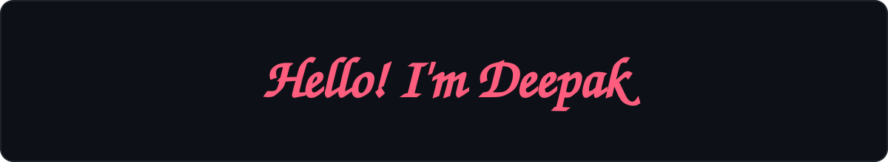
  <br />
  
  <br /><br />

  <a href="https://diviii.vercel.app/"></a>
  <a href="https://www.linkedin.com/in/deepak2405"></a>
  <a href="mailto:divi2749@gmail.com"></a>
  <a href="https://github.com/divi-24?tab=followers"></a>
</div>

<h3 align="center"><i>Curious mind. Useful work. Better every iteration.</i></h3>

## ✦ The Short Version

I take products from **idea to deployment**: understanding the problem, shaping the experience, building the system, and polishing the details that earn trust.

I work across interactive 3D web experiences, product strategy, and full-stack execution — turning complexity into clarity and ideas into experiences people actually want to use.

```text
think in systems  →  design with intent  →  build with care  →  ship what helps
```

- Former **Chief Marketing Officer at Dropp Services Pvt. Ltd.**, after progressing through frontend engineering, product strategy, and product management.
- **Best Mentor** at SSSC by TechNeeds, IGDTUW; mentored 200+ learners in web development and career readiness.
- **Project Admin** at GirlScript Summer of Code and Social Summer of Code.
- Top 11 team at **Hack'n'Solve, Devcation 2025**; open-source contributor, speaker, and hackathon builder.

## ⚡ How I Work

| I start with | I care about | I finish with |
| :-- | :-- | :-- |
| A real problem | Clear experiences | Something useful |
| Curiosity | Thoughtful details | A shipped product |
| A blank canvas | Strong systems | Room to improve |

## 🌐 Digital Coordinates

<div align="center">
  <a href="https://diviii.vercel.app/"></a>
  <a href="https://www.linkedin.com/in/deepak2405"></a>
  <a href="https://github.com/divi-24"></a>
  <a href="https://peerlist.io/divi_2405"></a>
  <a href="https://x.com/Divi_2405"></a>
  <a href="https://dev.to/divi-2405"></a>
  <a href="https://medium.com/@divi2749"></a>
  <a href="https://substack.com/@divi24"></a>
  <a href="https://www.reddit.com/user/Divi_2409/"></a>
  <a href="https://www.producthunt.com/@divi_2405"></a>
</div>

### Competitive programming

<div align="center">
  <a href="https://github.com/divi-24"></a>
  <a href="https://leetcode.com/u/divi_2405/"></a>
  <a href="https://codeforces.com/profile/Divi-2405"></a>
  <a href="https://www.codechef.com/users/divi_2405"></a>
</div>

## 🚀 Project Archive

A selection of experiments, products, and prototypes built around real-world problems:

| Project | The idea | Live |
| :-- | :-- | :-- |
| **SheSync** | AI-aware menstrual-health and wellness support for personalized care, education, and community. | [Open project](https://shesync-rouge.vercel.app/) |
| **IGDTUW 3D Map** | An interactive 3D campus experience for exploration and digital storytelling. | [Open project](https://igdtuw-map.vercel.app/) |
| **GitSee** | Discover, score, compare, and understand public GitHub repositories. | [Open project](https://gitsee-beta.vercel.app/) |
| **Thrive** | A collaborative space for developers, designers, and innovators solving hackathon challenges. | [Open project](https://thrve-hack.vercel.app/) |
| **Kisaan Setu** | Market information, agricultural resources, and expert guidance for farmers. | [Open project](https://kisaan-setu-f.vercel.app/) |
| **ResQPlate** | Connect restaurants and food businesses with local charities to rescue surplus food. | [Open project](https://resqplate.vercel.app/) |
| **Divios** | A creator portfolio platform built around 3D elements and motion. | [Open project](https://divios.vercel.app/) |
| **InnerBloom** | A mental-wellness space for reflection, resources, and supportive community. | [Open project](https://innerbloom.vercel.app/) |
| **Quake** | Earthquake awareness, real-time information, alerts, and safety guidance. | [Open project](https://quake-sigma.vercel.app/) |
| **Disaster Management** | Help communities stay informed, prepared, and connected during disasters. | [Open project](https://dm-two-pi.vercel.app/) |
| **Mapify** | Local discovery through maps, reviews, and community-shared experiences. | [Open project](https://mapp-roan.vercel.app/) |

> [**Walk through the full portfolio →**](https://diviii.vercel.app/)

## 🧰 Toolbox

<div align="center">
  
</div>

<details>
<summary><b>Full technical inventory</b></summary>

<br />

| Focus | Tools |
| :-- | :-- |
| **Languages** | JavaScript, TypeScript, Python, Java, C++, Go, Dart, HTML, CSS |
| **Frontend** | React, Next.js, Tailwind CSS, Three.js, React Three Fiber, Flutter |
| **Backend and data** | Node.js, NestJS, Express, REST APIs, MongoDB, MySQL, Firebase |
| **Product and delivery** | Git, GitHub, Postman, Figma, system design, open source, product strategy |

</details>

## 🏅 Credentials

<div align="center">
  <a href="https://www.credly.com/"></a>
  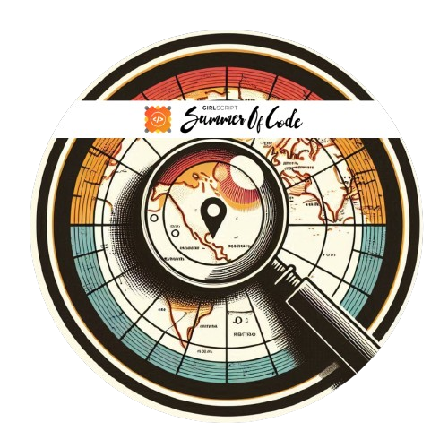
  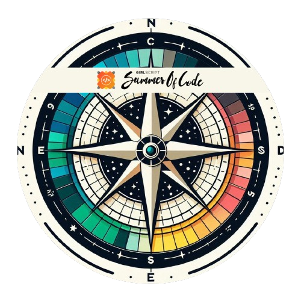
  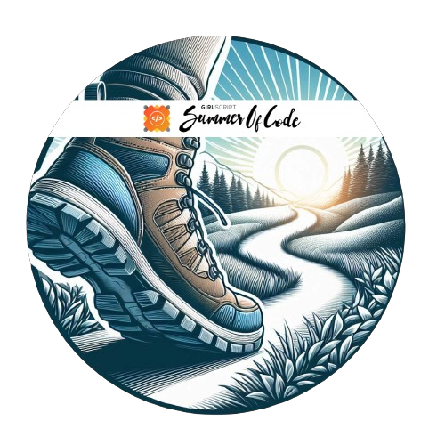
  
  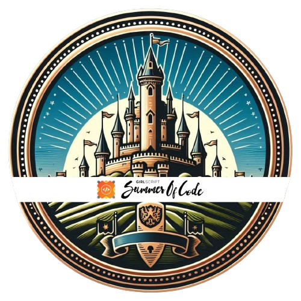
  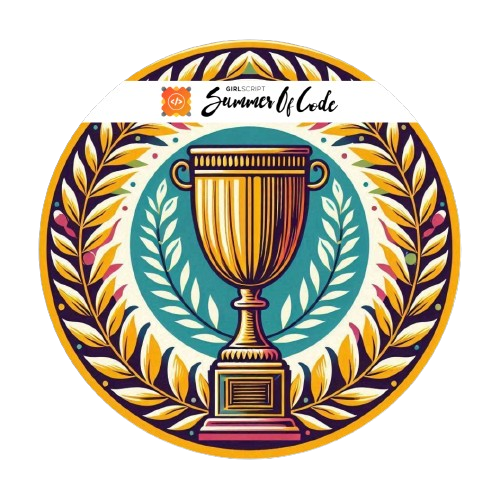
  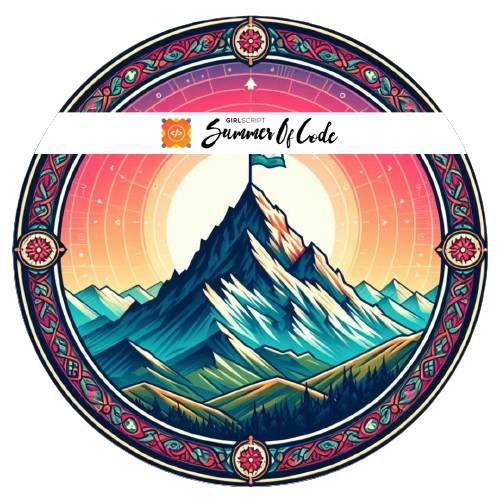
</div>

<div align="center">
  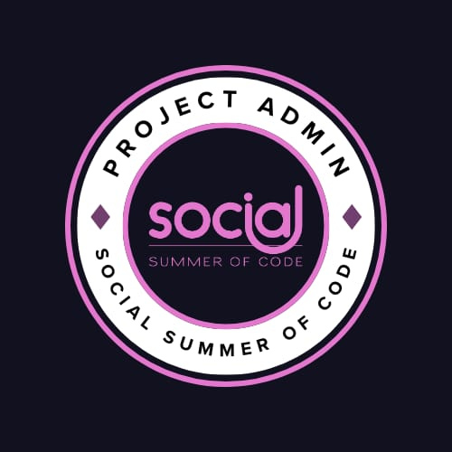
  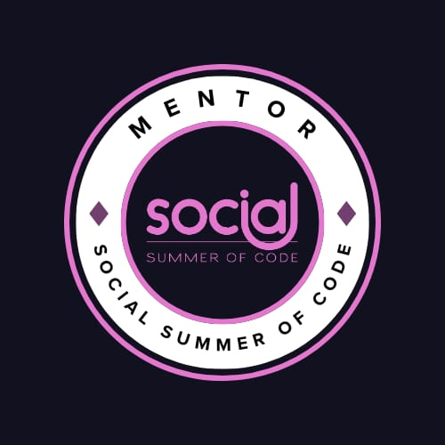
  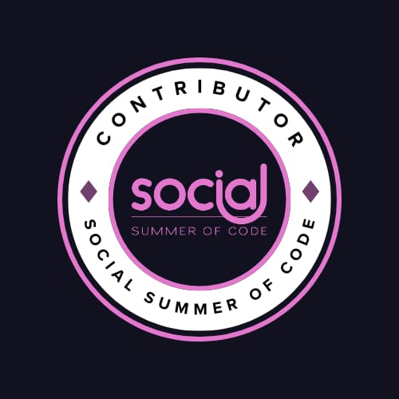
  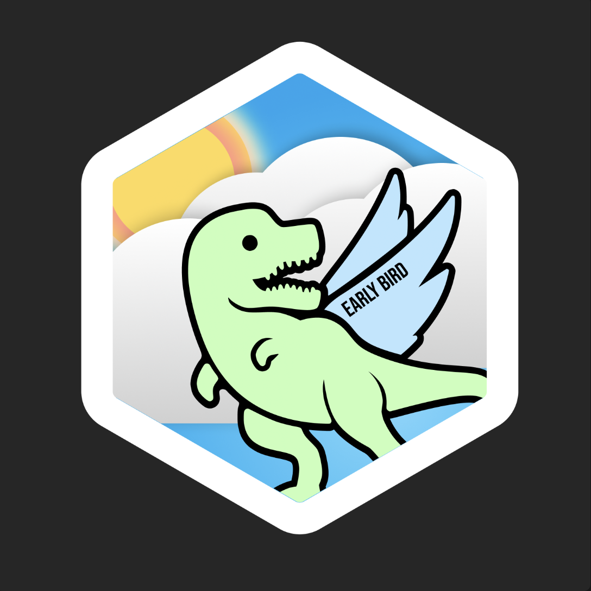
  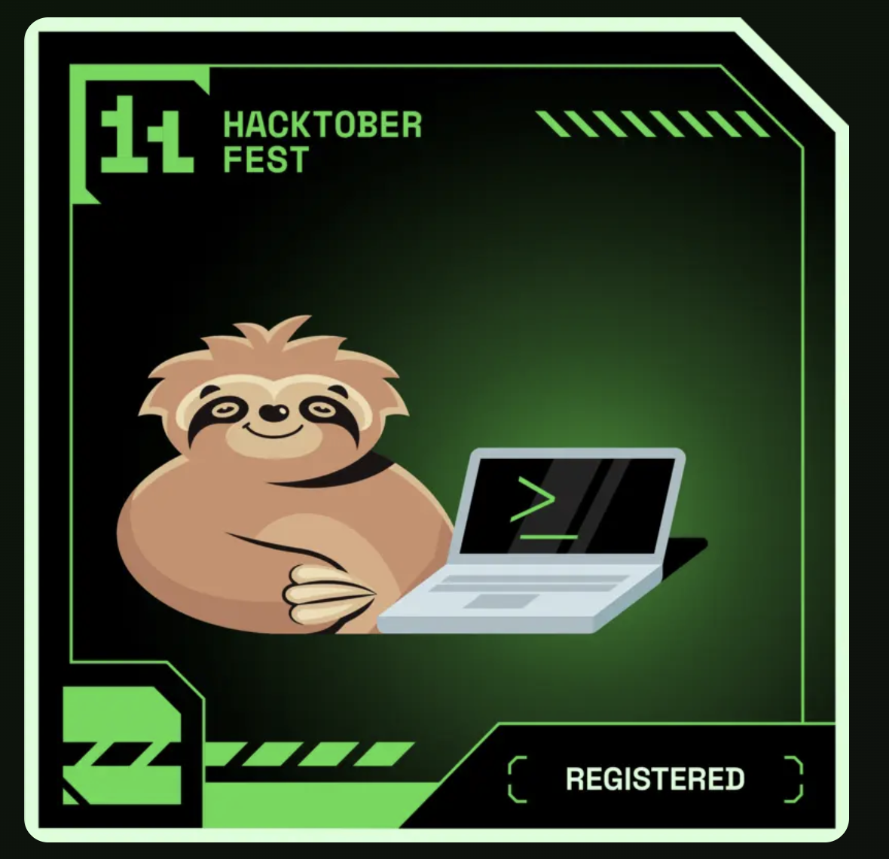
  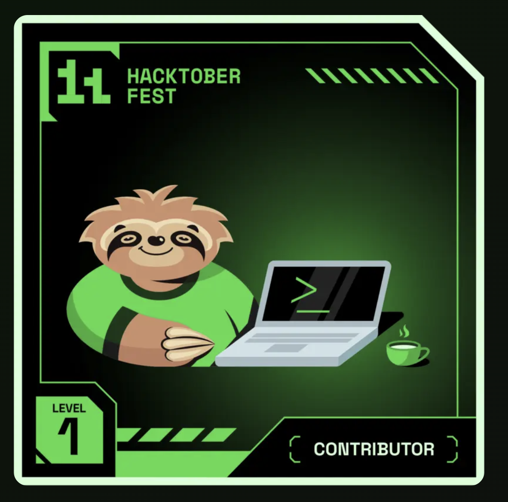
  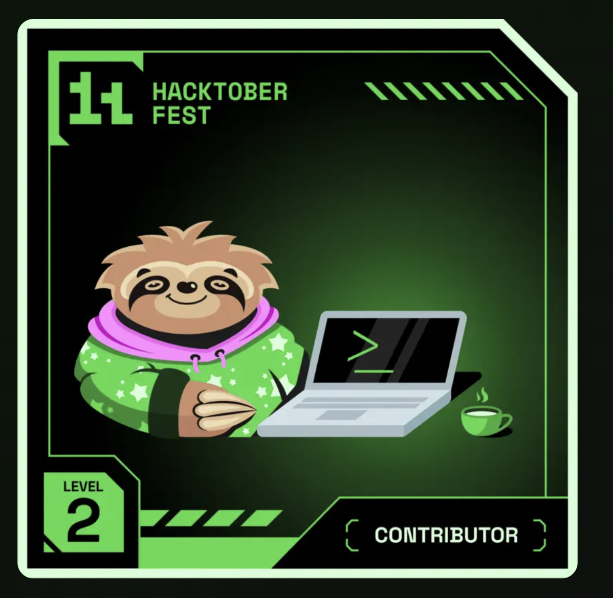
  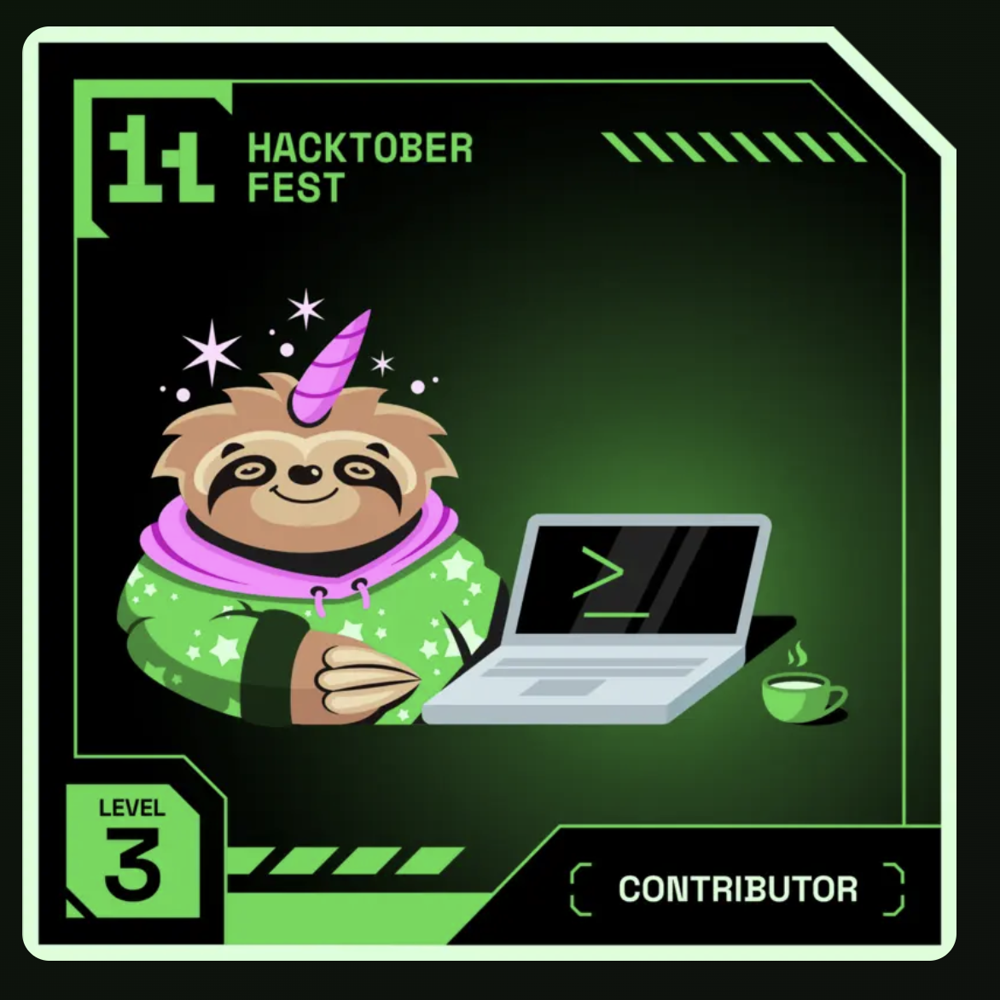
  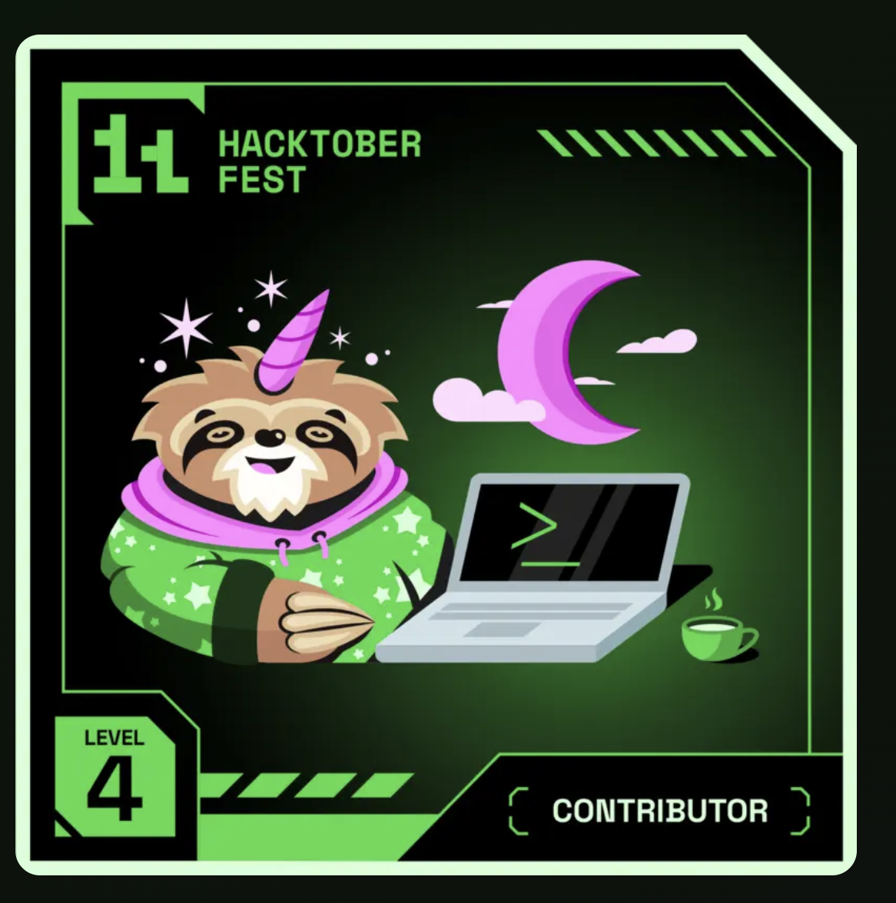
</div>

## ✍️ Beyond the Build

- [SheSync podcast: building accessible menstrual-health technology](https://www.youtube.com/watch?v=MqH9bZNVUbQ)
- Guest speaker on open source and contributions at Data Science Club, VIT Bhopal.
- [System-design notes and product thinking on Medium](https://medium.com/@divi2749)
- [“Why Leaves Are Better Than Human Beings” on Amazon](https://www.amazon.com/dp/B0GXMVZ8MQ)
- [“You Are The Product” on Amazon](https://www.amazon.com/dp/B0H83DFRFX)

<div align="center">
  <br />
  <sub>Building at the intersection of technology, empathy, and imagination.</sub>
</div>
