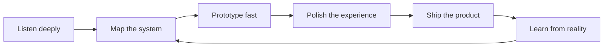

<!--
  GitHub profile README for @divi-24
  Deepak Gupta | Product thinker, frontend builder, systems shaper
-->

<div align="center">
  
  <br />
  
  <br />
  <br />
  <a href="https://diviii.vercel.app/"></a>
  <a href="https://www.linkedin.com/in/deepak2405"></a>
  <a href="mailto:divi2749@gmail.com"></a>
  <a href="https://github.com/divi-24?tab=followers"></a>
</div>

<h3 align="center"><i>Product imagination, frontend craft, and systems thinking in one build loop.</i></h3>

<p align="center">
  
  
  
  
</p>

---

## Command Center

```text
name        Deepak Gupta / divi-24
craft       product thinking -> interface design -> frontend engineering -> delivery
mission     turn ambiguity into useful, lovable, working software
signal      build with empathy, scale with systems, improve every iteration
current     shipping projects, mentoring builders, exploring product-led engineering
```

I am a builder who likes the whole arc: the first strange idea, the sketch that makes it clearer, the interface that gives it shape, the code that makes it real, and the feedback loop that makes it better.

## Build Philosophy

| When the problem is... | I become... | So the outcome is... |
| :-- | :-- | :-- |
| fuzzy | a product detective | a sharp user story |
| complex | a systems mapper | a simple interaction model |
| ambitious | a frontend architect | a product people can actually use |
| stuck | a patient debugger | momentum restored |
| promising | a relentless shipper | something real in the world |

```text
curiosity -> clarity -> prototype -> polish -> launch -> learn -> repeat
```

## Proof Of Work

<table>
  <tr>
    <td width="50%">
      <h3>Product + Leadership</h3>
      <ul>
        <li>Former Chief Marketing Officer at Dropp Services Pvt. Ltd.</li>
        <li>Worked across frontend engineering, product strategy, and product management.</li>
        <li>Built project narratives, launch thinking, and user-facing experiences.</li>
      </ul>
    </td>
    <td width="50%">
      <h3>Mentorship + Community</h3>
      <ul>
        <li>Best Mentor at SSSC by TechNeeds, IGDTUW.</li>
        <li>Mentored 200+ learners in web development and career readiness.</li>
        <li>Project Admin at GirlScript Summer of Code and Social Summer of Code.</li>
      </ul>
    </td>
  </tr>
  <tr>
    <td width="50%">
      <h3>Hackathon Energy</h3>
      <ul>
        <li>Top 11 team at Hack'n'Solve, Devcation 2025.</li>
        <li>Built fast under pressure, with product clarity and demo-ready polish.</li>
      </ul>
    </td>
    <td width="50%">
      <h3>Open Source Mindset</h3>
      <ul>
        <li>Contributor, speaker, mentor, and project collaborator.</li>
        <li>I like communities where people learn by building in public.</li>
      </ul>
    </td>
  </tr>
</table>

## Digital Coordinates

<div align="center">
  <a href="https://diviii.vercel.app/"></a>
  <a href="https://www.linkedin.com/in/deepak2405"></a>
  <a href="https://github.com/divi-24"></a>
  <a href="https://peerlist.io/divi_2405"></a>
  <a href="https://x.com/Divi_2405"></a>
  <a href="https://dev.to/divi-2405"></a>
  <a href="https://medium.com/@divi2749"></a>
  <a href="https://substack.com/@divi24"></a>
  <a href="https://www.reddit.com/user/Divi_2409/"></a>
  <a href="https://www.producthunt.com/@divi_2405"></a>
</div>

## Competitive Arena

<div align="center">
  <a href="https://leetcode.com/u/divi_2405/"></a>
  <a href="https://codeforces.com/profile/Divi-2405"></a>
  <a href="https://www.codechef.com/users/divi_2405"></a>
</div>

<br />

<div align="center">
  
  
</div>

## Project Constellation

| Project | Signal | Launch |
| :-- | :-- | :-- |
| **SheSync** | AI-aware menstrual-health support for personalized care, education, and community. | [Open](https://shesync-rouge.vercel.app/) |
| **IGDTUW 3D Map** | Interactive 3D campus exploration for wayfinding and digital storytelling. | [Open](https://igdtuw-map.vercel.app/) |
| **GitSee** | Discover, score, compare, and understand public GitHub repositories. | [Open](https://gitsee-beta.vercel.app/) |
| **Thrive** | Collaboration space for developers, designers, and innovators solving hackathon challenges. | [Open](https://thrve-hack.vercel.app/) |
| **Kisaan Setu** | Market information, agricultural resources, and expert guidance for farmers. | [Open](https://kisaan-setu-f.vercel.app/) |
| **ResQPlate** | Connect restaurants and food businesses with local charities to rescue surplus food. | [Open](https://resqplate.vercel.app/) |
| **Divios** | Creator portfolio platform built around 3D elements and expressive motion. | [Open](https://divios.vercel.app/) |
| **InnerBloom** | Mental-wellness space for reflection, resources, and supportive community. | [Open](https://innerbloom.vercel.app/) |
| **Quake** | Earthquake awareness, real-time information, alerts, and safety guidance. | [Open](https://quake-sigma.vercel.app/) |
| **Disaster Management** | Community preparedness, response information, and connected disaster support. | [Open](https://dm-two-pi.vercel.app/) |
| **Mapify** | Local discovery through maps, reviews, and community-shared experiences. | [Open](https://mapp-roan.vercel.app/) |

<div align="center">
  <a href="https://diviii.vercel.app/"></a>
</div>

## Builder's Arsenal

<div align="center">
  
</div>

<br />

| Layer | Tools I reach for |
| :-- | :-- |
| **Languages** | JavaScript, TypeScript, Python, Java, C++, Go, Dart, HTML, CSS |
| **Frontend** | React, Next.js, Tailwind CSS, Three.js, React Three Fiber, Flutter |
| **Backend and data** | Node.js, NestJS, Express, REST APIs, MongoDB, MySQL, Firebase |
| **Product and delivery** | Git, GitHub, Postman, Figma, system design, open source, product strategy |

## Operating System



## Achievement Shelf

<div align="center">
  <a href="https://www.credly.com/"></a>
  
  
  
  
  
  
  
</div>

<div align="center">
  
  
  
  
  
  
  
  
  
</div>

## Beyond The Build

- [SheSync podcast: building accessible menstrual-health technology](https://www.youtube.com/watch?v=MqH9bZNVUbQ)
- [Guest speaker on open source and contributions at Data Science Club, VIT Bhopal](https://youtube.com/live/xnOeJgy-sK8?si=8x1LD1PLGDodyiG9).
- [System-design notes and product thinking on Medium](https://medium.com/@divi2749)
- [Why Leaves Are Better Than Human Beings on Amazon](https://www.amazon.com/dp/B0GXMVZ8MQ)
- [You Are The Product on Amazon](https://www.amazon.com/dp/B0H83DFRFX)

---

<div align="center">
  
</div>
