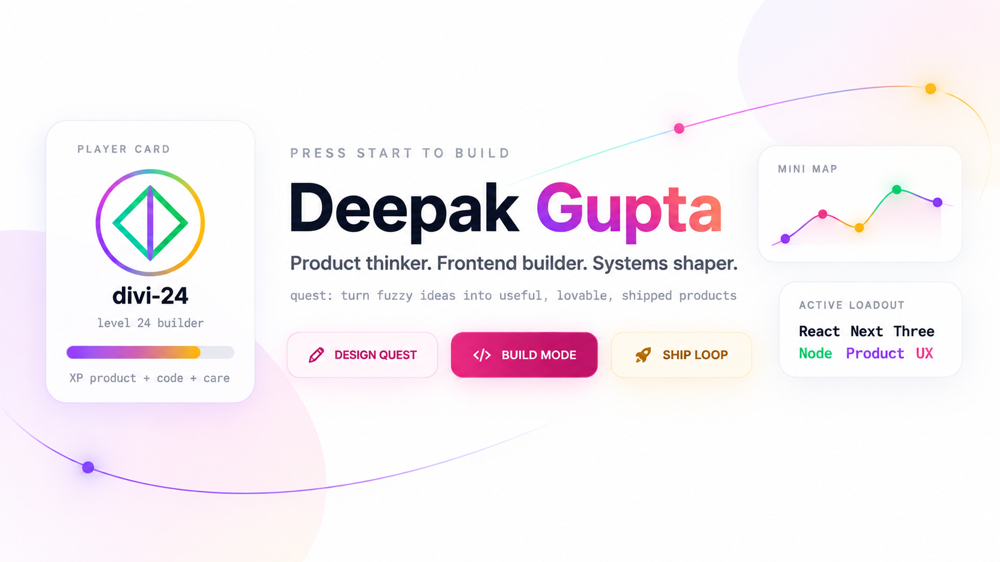

<!--
  GitHub profile README for @divi-24
  Deepak Gupta | Product thinker, frontend builder, systems shaper
-->

<div align="center">
  
  <br />
  
  <br />
  <br />
  <a href="https://diviii.vercel.app/"></a>
  <a href="https://www.linkedin.com/in/deepak2405"></a>
  <a href="mailto:divi2749@gmail.com"></a>
  <a href="https://github.com/divi-24?tab=followers"></a>
</div>

<h3 align="center"><i>Player class: product-minded frontend engineer. Special move: turning ambiguity into shipped software.</i></h3>

<p align="center">
  
  
  
  
</p>

---

## Start Screen

```text
PLAYER      Deepak Gupta / divi-24
CLASS       product thinker + frontend builder + systems shaper
HOME BASE   Delhi, India
MAIN QUEST  make useful products feel clear, alive, and human
BUILD LOOP  listen -> map -> prototype -> polish -> ship -> learn
POWER UPS   empathy, motion, systems, open source, product taste
```

I like building the full journey: the messy idea, the product logic, the interface, the code, the launch, the feedback, and the next better version. My favorite projects feel like small worlds: useful, intentional, and a little bit memorable.

## Player Stats

<table>
  <tr>
    <td align="center" width="25%">
      <h3>Product Sense</h3>
      <p>Turns unclear ideas into sharp user stories, flows, and launch-ready features.</p>
    </td>
    <td align="center" width="25%">
      <h3>Frontend Craft</h3>
      <p>Builds interfaces with React, Next.js, Tailwind, Three.js, and interaction polish.</p>
    </td>
    <td align="center" width="25%">
      <h3>Systems Energy</h3>
      <p>Designs clean structures, reusable patterns, and workflows that can scale.</p>
    </td>
    <td align="center" width="25%">
      <h3>Community XP</h3>
      <p>Mentors builders, contributes to open source, speaks, leads, and keeps learning.</p>
    </td>
  </tr>
</table>

```text
product strategy  [█████████░]  90
frontend craft    [█████████░]  92
systems thinking  [████████░░]  86
mentorship        [█████████░]  91
ship velocity     [████████░░]  88
```

## Quest Log

| Quest | Status | Reward |
| :-- | :-- | :-- |
| Former Chief Marketing Officer at Dropp Services Pvt. Ltd. | Cleared | Product strategy + leadership XP |
| Best Mentor at SSSC by TechNeeds, IGDTUW | Cleared | 200+ learners mentored |
| Project Admin at GirlScript Summer of Code and Social Summer of Code | Cleared | Open-source leadership |
| Top 11 team at Hack'n'Solve, Devcation 2025 | Cleared | Hackathon battle-tested shipping |
| Open-source contributor, speaker, and hackathon builder | Active | Community compounding |

## World Map

| World | Build | Portal |
| :-- | :-- | :-- |
| **SheSync** | AI-aware menstrual-health support for personalized care, education, and community. | [Enter](https://shesync-rouge.vercel.app/) |
| **IGDTUW 3D Map** | Interactive 3D campus exploration for wayfinding and digital storytelling. | [Enter](https://igdtuw-map.vercel.app/) |
| **GitSee** | Discover, score, compare, and understand public GitHub repositories. | [Enter](https://gitsee-beta.vercel.app/) |
| **Thrive** | Collaboration space for developers, designers, and innovators solving hackathon challenges. | [Enter](https://thrve-hack.vercel.app/) |
| **Kisaan Setu** | Market information, agricultural resources, and expert guidance for farmers. | [Enter](https://kisaan-setu-f.vercel.app/) |
| **ResQPlate** | Connect restaurants and food businesses with local charities to rescue surplus food. | [Enter](https://resqplate.vercel.app/) |
| **Divios** | Creator portfolio platform built around 3D elements and expressive motion. | [Enter](https://divios.vercel.app/) |
| **InnerBloom** | Mental-wellness space for reflection, resources, and supportive community. | [Enter](https://innerbloom.vercel.app/) |
| **Quake** | Earthquake awareness, real-time information, alerts, and safety guidance. | [Enter](https://quake-sigma.vercel.app/) |
| **Disaster Management** | Community preparedness, response information, and connected disaster support. | [Enter](https://dm-two-pi.vercel.app/) |
| **Mapify** | Local discovery through maps, reviews, and community-shared experiences. | [Enter](https://mapp-roan.vercel.app/) |

<div align="center">
  <a href="https://diviii.vercel.app/"></a>
</div>

## Skill Tree

<div align="center">
  
</div>

<br />

| Branch | Unlocked tools |
| :-- | :-- |
| **Interface magic** | React, Next.js, Tailwind CSS, Three.js, React Three Fiber, Flutter |
| **Logic engine** | JavaScript, TypeScript, Python, Java, C++, Go, Dart |
| **Backend rooms** | Node.js, NestJS, Express, REST APIs, MongoDB, MySQL, Firebase |
| **Launch kit** | Git, GitHub, Postman, Figma, Vercel, product strategy, system design |

## Live Scoreboard

<div align="center">
  
  
</div>

<div align="center">
  
</div>

<div align="center">
  
  
  
  
</div>

## Competitive Arena

<div align="center">
  <a href="https://leetcode.com/u/divi_2405/"></a>
  <a href="https://codeforces.com/profile/Divi-2405"></a>
  <a href="https://www.codechef.com/users/divi_2405"></a>
</div>

## Achievement Shelf

<div align="center">
  <a href="https://www.credly.com/"></a>
  
  
  
  
  
  
  
</div>

<div align="center">
  
  
  
  
  
  
  
  
  
</div>

## Signal Network

<div align="center">
  <a href="https://diviii.vercel.app/"></a>
  <a href="https://www.linkedin.com/in/deepak2405"></a>
  <a href="https://github.com/divi-24"></a>
  <a href="https://peerlist.io/divi_2405"></a>
  <a href="https://x.com/Divi_2405"></a>
  <a href="https://dev.to/divi-2405"></a>
  <a href="https://medium.com/@divi2749"></a>
  <a href="https://substack.com/@divi24"></a>
  <a href="https://www.reddit.com/user/Divi_2409/"></a>
  <a href="https://www.producthunt.com/@divi_2405"></a>
</div>

## Lore Drops

- [SheSync podcast: building accessible menstrual-health technology](https://www.youtube.com/watch?v=MqH9bZNVUbQ)
- [Guest speaker on open source and contributions at Data Science Club, VIT Bhopal](https://youtube.com/live/xnOeJgy-sK8?si=8x1LD1PLGDodyiG9)
- [System-design notes and product thinking on Medium](https://medium.com/@divi2749)
- [Why Leaves Are Better Than Human Beings on Amazon](https://www.amazon.com/dp/B0GXMVZ8MQ)
- [You Are The Product on Amazon](https://www.amazon.com/dp/B0H83DFRFX)

---

<div align="center">
  
</div>
